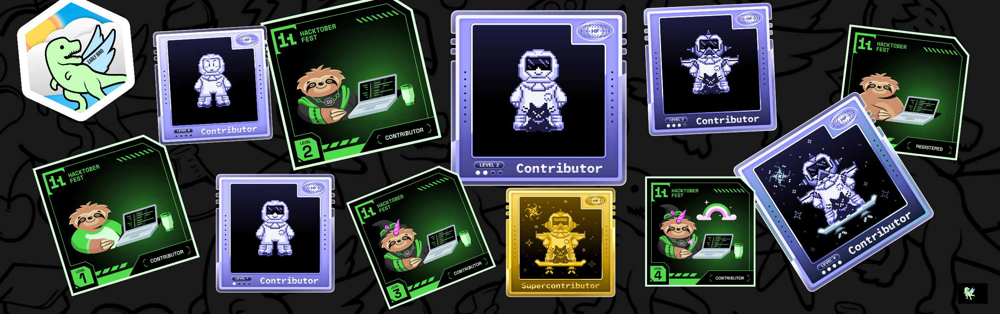

  

###

  
  
  
  
  
  
  

###

<h1 align="center">Coder from CEYLON 🇱🇰</h1>

  

###

<h3 align="left">Who am I?</h3>

###

I'm a Software Engineering graduate from <b>SLIIT</b> with <b>2+ years</b> of professional experience in full-stack software development, based in Sri Lanka.
I build scalable applications with <b>Java, Spring Boot, React, Next.js, TypeScript, Laravel</b> and RESTful APIs, and I'm experienced in Agile development, database integration, testing, automation and production deployment.
Right now I'm especially interested in scalable software solutions and <b>AI/ML-powered applications</b> — computer vision, LLMs and RAG.

###

<h3 align="left">My GitHub Stats</h3>

  
  

  

###

<h3 align="left">Languages</h3>

###

  
  
  
  
  
  
  
  
  
  
  

###

<h3 align="left">Frontend</h3>

###

  
  
  
  
  
  
  
  
  
  
  

###

<h3 align="left">Backend & Databases</h3>

###

  
  
  
  
  
  
  
  
  
  
  
  
  

###

<h3 align="left">AI & Machine Learning</h3>

###

  
  
  
  
  
  
  <picture>
    <source media="(prefers-color-scheme: dark)" srcset="https://cdn.jsdelivr.net/npm/@lobehub/icons-static-png@1.75.0/dark/openai.png" />
    
  </picture>
  
  
  
  

###

<h3 align="left">Tools and Technologies</h3>

###

  
  
  
  
  
  
  
  
  
  
  
  
  
  
  
  
  
  
  

###

<h3 align="center">Exploring Clouds</h3>

###

  
  
  
  
  

###

<h3 align="center">Badges</h3>

###

  

###

  

###

  

